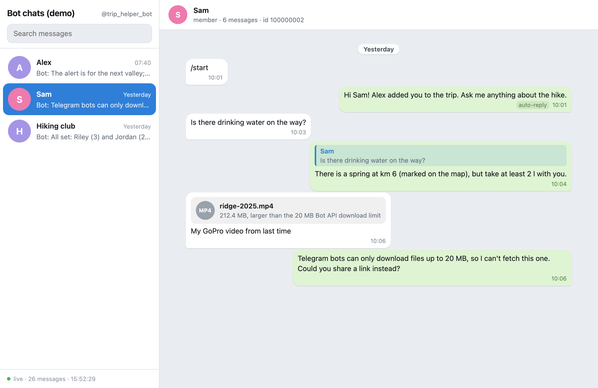
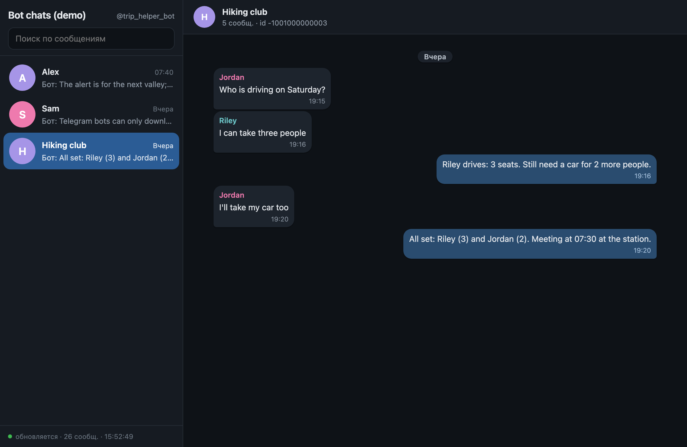

# bot-viewer

A local, read-only web viewer for everything your Telegram bot has received and sent:
chats in a sidebar, a messenger-like feed with days, replies, forwards, edits and attachments
(image previews, video and audio players, files), full-text search and live updates.



<sub>Demo data only: the people, chats and pictures are made up.</sub>

## Why

The Telegram Bot API has **no method to read chat history**. A bot only sees updates as they
arrive (`getUpdates` or a webhook) and the results of its own `send*` calls; once processed,
they are gone. There is also no Telegram client in which you can see the conversations of
your bot as the bot sees them.

So bot-viewer splits the job in two:

1. **Your bot writes a journal**: one JSON line per incoming or outgoing message
   (`bot_journal.py` does it in one call; you can also write the lines yourself).
2. **The viewer reads the journal** and shows it in your browser at `http://127.0.0.1:8797/`.
   It never talks to Telegram, needs no bot token and does not interfere with a running bot.

## Features

- Chats with the last message, unread counters and per-chat search hit counts.
- Feed grouped by day: incoming messages on the left, the bot's on the right; group chats show
  the sender's name.
- Replies (click the quote to jump to the original), forwards, edits (latest text, with the edit
  time), "silent" and "auto-reply" tags, full timestamp and `message_id` on hover.
- Attachments: image previews, video/audio players with seeking, files with **Open** and
  **Show in folder**; notes for files the bot could not download (for example over the 20 MB
  Bot API limit).
- New messages appear automatically (polling every 3 s, every 30 s in a background tab).
- Links to a chat and a search: `http://127.0.0.1:8797/#chat=123456789&q=photo`.
- Light and dark theme from the system, English and Russian UI.
- Python 3.8+ standard library only, a single HTML file, no build step, no dependencies.

| Dark theme, group chat, Russian UI |
|---|
|  |

## Quick start

```sh
git clone https://github.com/Jimmo910/bot-viewer.git
cd bot-viewer
python3 bot_viewer.py --config demo/config.json      # try it with the demo data
```

The server starts in the background, the page opens in your default browser, and the server
exits by itself 30 minutes after the last open page is closed.

For your own bot:

```sh
cp config.example.json config.json    # then edit it: journal path, chat names
python3 bot_viewer.py
```

Command line:

| Command | What it does |
|---|---|
| `python3 bot_viewer.py` | open the viewer (starts the server if needed) |
| `--config PATH` | use another config file (default: `config.json` next to the script) |
| `--no-browser` | start the server and print the URL only |
| `--check` | print a summary of the data (chats, attachments, missing files) and exit |
| `--serve` | run the server in the foreground (debugging) |
| `--stop` | stop the background server |

On macOS, `scripts/make_macos_app.sh [folder] [name] [config]` builds a small app
(default: `~/Applications/Bot Viewer.app`) that opens the viewer with a double click.

## Configuration

`config.json` (git-ignored; see `config.example.json`):

```json
{
  "bot_name": "my_bot",
  "title": "Bot chats",
  "journals": ["~/my-bot/data/journal.jsonl"],
  "chats": {
    "123456789": {"name": "Alice", "role": "owner"},
    "987654321": "Bob"
  },
  "lang": "auto",
  "port": 8797,
  "idle_exit": 1800
}
```

| Key | Meaning |
|---|---|
| `journals` (or `journal`) | One or more JSONL files. Relative paths are resolved against the config's folder. When the same message appears in several journals, the later file wins, so you can put an imported archive first and the live journal last. |
| `chats` | Display names for chat ids (a string, or `{"name", "role"}`). The `owner` chat opens first. Chats that are not listed still appear, named after the sender. |
| `bot_name`, `title` | Shown in the sidebar header. |
| `lang` | `auto` (browser language), `en` or `ru`. |
| `port` | Preferred port; if it is busy, any free port is used. |
| `idle_exit` | Seconds without an open page before the background server exits. |

Environment overrides: `BOT_VIEWER_CONFIG`, `BOT_VIEWER_JOURNAL` (paths separated by `:`),
`BOT_VIEWER_PORT`, `BOT_VIEWER_IDLE_EXIT`, `BOT_VIEWER_RUN_DIR`.

## Journal format

A UTF-8 [JSON Lines](https://jsonlines.org/) file, one message per line, append-only.
Lines that are not valid JSON or lack `dir`/`chat_id` are skipped.

```json
{"time": "2026-10-10 09:12:03", "dir": "in", "chat_id": 123456789, "user": "Alice", "message_id": 7, "text": "Here is the route", "attachments": [{"kind": "photo", "path": "files/route.jpg"}]}
{"time": "2026-10-10 09:12:30", "dir": "out", "chat_id": 123456789, "message_id": 8, "text": "Got it: 11.4 km", "reply_to": 7}
```

| Field | Required | Meaning |
|---|---|---|
| `dir` | yes | `in` (received by the bot) or `out` (sent by the bot) |
| `chat_id` | yes | Telegram chat id (negative for groups) |
| `time` | recommended | local time `YYYY-MM-DD HH:MM:SS` (ISO 8601 with `T` works too); used for sorting and day headers |
| `message_id` | recommended | Telegram message id; used to merge duplicates, apply edits and resolve replies |
| `user` | | sender's display name (names unknown chats and group senders) |
| `text` | | message text or media caption |
| `attachments` | | list of `{kind, path, name, size, note}`; `kind` is `photo`, `video`, `video_note`, `animation`, `voice`, `audio`, `document`, `sticker`, `location`, `contact`, `poll` or any other string; `path` is a local file (absolute, or relative to the journal); without `path`, only `name`/`note` are shown |
| `reply_to`, `reply_quote` | | id and text of the message being replied to |
| `forward` | | name of the original sender of a forwarded message |
| `edited`, `edit_time` | | `true` for an edited version of a message: log it as a new line with the same `dir`, `chat_id` and `message_id`; the viewer shows the latest text |
| `silent` | | sent without notification |
| `via` | | free-form source tag shown on hover; `auto` marks automatic replies |

Unknown fields are ignored, so you can store anything else you need.

## Writing the journal from your bot

The Bot API cannot give you the history later, so log messages **as they happen**: every
incoming update and the `Message` object returned by every `send*` call. Media are not in the
update itself; if you want previews, download the file with `getFile` and log its local path.

`bot_journal.py` (standard library only, copy it into your project or import it) turns a Bot API
`Message` dict into a journal line and appends it safely:

```python
import bot_journal

JOURNAL = "data/journal.jsonl"

# incoming: update["message"] or update["edited_message"]
bot_journal.log_message(JOURNAL, update["message"], "in")
bot_journal.log_message(JOURNAL, update["message"], "in", path="/srv/my-bot/downloads/photo_123.jpg")

# outgoing: the "result" of sendMessage / sendPhoto / ...
result = api("sendMessage", chat_id=chat_id, text="Hello!")
bot_journal.log_message(JOURNAL, result, "out")
bot_journal.log_message(JOURNAL, result, "out", via="auto", silent=True)
```

With **python-telegram-bot**:

```python
async def on_message(update, context):
    bot_journal.log_message(JOURNAL, update.effective_message.to_dict(), "in")
    sent = await update.effective_message.reply_text("Got it")
    bot_journal.log_message(JOURNAL, sent.to_dict(), "out")
```

With **aiogram 3**:

```python
@router.message()
async def on_message(message: Message):
    dump = lambda m: m.model_dump(mode="json", by_alias=True, exclude_none=True)
    bot_journal.log_message(JOURNAL, dump(message), "in")
    sent = await message.answer("Got it")
    bot_journal.log_message(JOURNAL, dump(sent), "out")
```

Without the helper, append one `json.dumps(entry, ensure_ascii=False) + "\n"` per message to
the file opened in append mode. If several processes write the same journal (for example the
bot and a separate sender script), keep each write to one line; the viewer reads the file again
whenever it changes.

## Security and privacy

bot-viewer shows private conversations, so it is built to stay on your machine:

- **Local only.** The server binds to `127.0.0.1`; it is not reachable from the network.
- **Read-only.** It never writes to the journals, never contacts Telegram and needs no token.
- **No arbitrary files.** It serves only files that are listed as attachments in the journal,
  by an opaque id; request paths are never mapped to the file system.
- **Browser protections.** Requests with a foreign `Host` header are rejected (DNS rebinding);
  `POST` actions (Open / Show in folder) require a same-origin `Origin`; no CORS; a strict
  Content-Security-Policy, `nosniff`, `no-referrer` and no framing.
- **Your data stays out of git.** `config.json`, `data/`, `run/` and `*.jsonl` (except the demo)
  are in `.gitignore`.

The journal is trusted input: anyone who can write to it can make the viewer serve any file
your user can read (by listing it as an attachment). Keep the journal and its folder writable
only by you and your bot. Anyone with access to your user account can open the viewer, just as
they could read the journal itself.

## Development

```sh
python3 -m unittest -v      # offline tests: config, merging, the journal writer, HTTP access rules
python3 bot_viewer.py --config demo/config.json --serve
```

Files: `bot_viewer.py` (server), `viewer.html` (the page), `bot_journal.py` (journal writer),
`demo/` (made-up data for the screenshots and tests), `scripts/make_macos_app.sh`, `tests/`.

## License

[MIT](LICENSE)

---

## Кратко по-русски

**bot-viewer** — локальный просмотрщик переписки Telegram-бота: чаты, лента как в мессенджере,
ответы, пересылки, правки, вложения с превью, поиск, автообновление.

Bot API не умеет отдавать историю чатов, поэтому бот сам пишет журнал — по строке JSON на каждое
входящее и исходящее сообщение (готовая функция — `bot_journal.log_message`). Просмотрщик только
читает журнал и показывает его в браузере на `http://127.0.0.1:8797/`. С Telegram он не
связывается, токен ему не нужен.

Запуск: `cp config.example.json config.json`, указать путь к журналу и имена чатов, затем
`python3 bot_viewer.py`. Демо: `python3 bot_viewer.py --config demo/config.json`. Интерфейс
переключается на русский по языку браузера или параметром `"lang": "ru"`.

Безопасность: сервер слушает только `127.0.0.1`, ничего не меняет и отдаёт только файлы-вложения
из журнала. Конфиг и данные в git не попадают.
